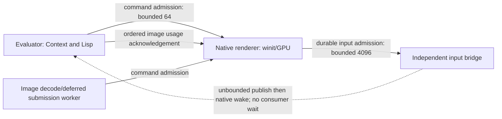

# Renderer/input backpressure: wait graph and progress contract

Status: proposed for peer review; no implementation or test executed yet.
Date: 2026-11-22.
Task: N-render-input-backpressure-cycle (lead mail10804; peer10807/10813).
Source baseline: main `7081390b09baeb46530e5b674a366e7c309d1b5a`.
Prospective image-cache change: `2641d18d65847be732747992a7758f59030dc456`,
rebased in the 74c candidate as `06f2bef0be`; its code was also read at
`203ef106a9`. References below name their baseline explicitly.

## Finding and proposed scope

The current GUI has three execution owners, not two: evaluator, native
renderer/event loop, and an independent input bridge. The bridge forwards
the bounded native input stream into an unbounded evaluator input stream.
Consequently, Lisp not reading input, even during an ordered image-cache
request, does not by itself close a queue wait cycle.

The inspected bridge publication paths do not wait for evaluator consumption,
run Lisp, acquire an evaluator/GC lock, or hold a shared application mutex
across a renderer request. On Linux, their normal wake uses a coalesced
nonblocking eventfd notification. Under finite work and fair scheduling the
queue dependencies are acyclic. This is a source-level argument, not an
observed no-deadlock result or an unconditional latency guarantee.

The proposed result of this item is that argument plus a bounded-deadline
progress test through the actual publication and image-catalog interfaces.
Do not change the transport or weaken image-cache freshness to fix an
unreproduced cycle. If the progress test identifies a real additional wait
edge, revise this note and write the corresponding failing row before a fix.
The separate 74c rich-buffer shaping regression is not this item.

## Owners and wait graph

A dashed publication arrow is not a wait-for edge. Neither withholding Lisp
input consumption nor filling the evaluator's unbounded queue adds an E-to-B
ownership edge. A permanently suspended bridge can stall the renderer, but
that is an additional premise, not a demonstrated evaluator-held resource.
External logging I/O, allocation failure, a stalled OS/GPU, and scheduler
starvation are also outside a proof about these application queue edges.

## Communication inventory

Locations in this table are at7081390b09 unless explicitly marked2641/203ef.

| Owner / operation | Source | What can wait; saturation / release condition |
|---|---|---|
| Evaluator publishes ordinary native command | `crates/neomacs/src/main.rs:1824-1834`; `crates/neomacs-display-runtime/src/thread_comm/command_projection.rs:24-26,43-45` | Command queue capacity64 (`thread_comm.rs:830-831`). Admission blocks when64 earlier commands remain. Renderer draining or disconnect releases it. Native wake occurs after admission. |
| Clipboard and video request replies | `main.rs:1840-1847,3146-3179` | Reply deadlines are5s, but do not bound the preceding blocking command admission. Reply channels are fresh capacity1 with one expected completion. |
| Ordered image invalidation and usage publish on existing main | `crates/neomacs/src/image_catalog.rs:400-465` | Admission and usage ack have separate100ms bounds. This can return a stale total and is why2641 exists; restoring these timeouts is not an acceptable freshness fix. |
| Ordered image invalidation on2641/203ef | `image_catalog.rs:396-446,519-561,880-893` at203ef | Direct blocking command admission for flush/clear/usage, then `wait.recv()` for usage publication. Same evaluator publishes invalidation before usage. Renderer command handling or disconnect releases these waits. |
| Renderer publishes durable input | `thread_comm.rs:1284-1359` | Native input queue capacity4096 (`:830,1069`). All non-lossy events use `input_tx.send`; a full queue waits for the independent bridge, not directly for Lisp. |
| Renderer publishes lossy state | `thread_comm.rs:1196-1206,1322-1342` | Pointer movement and WebView load progress use `try_send`; full/disconnected returns immediately. Existing loss/coalescing policy is not permission to discard key/button/close/presentation obligations. |
| Renderer drains commands | `render_thread/app_handler.rs:70-78`; `lifecycle.rs:364`; `command_processing.rs:9-38` | `try_recv` loop does not wait for command availability. A blocked native callback or command-generated input send can prevent reaching/continuing this pump. |
| Commands can publish input too | `render_thread/surface_resize.rs:137-147`; `window_commands.rs:312`; `ui_commands.rs:107-127` | Resize/completion, retirement, menu cancellation and similar results traverse the same durable input send. Backpressure can stall inside command execution, not only native key callbacks. |
| Renderer publishes usage ack | `render_thread/asset_commands.rs:217-221` (2641 retains nonblocking ack) | `ack.try_send(())` into the fresh one-reply channel. No evaluator-consumption wait. Publication precedes ack. |
| Other one-shot asset/startup replies | `render_thread/asset_commands.rs:322,345`; `gpu_startup.rs:32-41`; `startup.rs:61-85`; `thread_handle.rs:20,53-59` | Fresh capacity1 reply, one terminal producer. A protocol-correct single terminal response has capacity even if evaluator/owner has not received it; receiver drop returns an error. Startup waits are separately deadline/lifetime guarded. |
| Frame publication | `thread_comm/frame_mailbox.rs:51-84,102-142` | Per-frame coalescing under a short mailbox mutex; availability signal uses `try_send` into capacity1. Receiver `recv()` may wait for availability; normal GUI ingestion uses `try_recv`. No mailbox guard spans a channel wait. |
| Ordinary image/decode submission worker | `image_catalog.rs:1094-1157` | Evaluator first uses `try_send`; on full it submits to an unbounded deferred queue. That independent worker can block on renderer command admission. It does not own/drain native input. Ordered cache invalidations in2641 do not use this deferral path. |
| Image redisplay waker | `image_catalog.rs:119-124` | Publishes `LayoutInvalidated` directly into HostInputPublisher's unbounded evaluator stream. It does not consume native4096 capacity or wait for evaluator consumption. |
| GUI bridge receive | `main.rs:4719,4731-4808` | `select!` waits for native input/font changes/retry deadline. Native input receipt releases renderer queue capacity before conversion/publication. Font observer disconnect replaces that arm with `never`; native input disconnect ends the loop. |
| Bridge font-render reverse publication | `main.rs:4736-4753` | `try_send` only; remembers the latest policy snapshot and retries after10ms if command64 is full. It keeps draining native input. This deliberately avoids B-to-R blocking. |
| Bridge forwards into evaluator | `crates/neomacs/src/input_bridge/publication.rs:149-193`; `crates/neovm-system/src/emacs_core/system/host_input.rs:277-310,388-393,410-434` | Unbounded core channel, then one wake for the committed conversion batch. Allocation is possible, but no channel capacity or consumer-ack wait exists. Receiver closure is terminal, not a retry of an already committed prefix. |
| Renderer final exit notification | `render_thread/bootstrap.rs:566,616` | Raw cloned `input_tx.send(WindowClose)` can wait for native-input capacity after the render loop exits. Record as a teardown dependency; it is not proof that the input bridge waits for evaluator consumption. |
| Evaluator normal shutdown command | `main.rs:4879-4882` | `try_send(Shutdown)` ignores Full and wakes. This is a separate durability concern, not a blocking edge. See follow-ups below. |

There is no source basis here for claiming every OS/library call is wait-free.
The inventory concerns application queue admission/replies and the bridge's
shared-state dependencies. Asset rendering can additionally wait on OS/GPU
work; those waits require a separate concrete evaluator-held resource before
they become evidence for this proposed cycle.

## Bridge publication audit

The module interface is `InputPublisher::publish_display/publish_core`.
Production and the progress test should cross that seam, retaining conversion,
frame routing, early quit, publication order and native notification together.

1. `input_bridge.rs:277-315,405-490` converts typed Rust data, including tracked
   receipts and presentation-qualified pointer input. It does not call Context,
   Lisp, an interner, or a GC safepoint. Internal presentation events stay in
   the same ordered stream as user actions.
2. `record_primary_window_resize` (`main.rs:1760-1785`) and primary-frame route
   resolution (`publication.rs:55-70`) take short copy/update mutexes. Audited
   evaluator writes (`main.rs:1954-1958,2057-2061,2252-2257`) release these
   guards before native command publication. No opposing lock/wait was found.
3. Early default C-g (`publication.rs:178-182`) calls `QuitRequest::request`
   (`crates/neovm-value/src/quit.rs:138-143`): atomic flag swap plus attention
   accounting, not evaluator acknowledgement or managed allocation.
4. `PublicationSession::enqueue/finish` (`host_input.rs:277-310`) borrows the
   connection, enqueues to the unbounded channel, and finishes its prefix
   notification (`:231-240`). Per-event publication neither clones/drops the
   session owner nor calls session nudge/disconnect.
5. `WaitNotifier::notify` (`crates/neovm-eval/src/emacs_core/runtime/eval/data/process_state.rs:1635-1641`)
   stores an atomic pending flag then calls `polling::Poller::notify`. The
   locked polling3.11.0 implementation coalesces via CAS (`src/lib.rs:799-812`),
   outside the wait mutex (`:751`); Linux normally writes an eventfd created
   NONBLOCK (`src/epoll.rs:444,488-498`). No evaluator reply is needed. Do not
   infer universal platform wait-freedom from this Linux source reading.
6. Host-session nudge is install-time (`host_input.rs:355-367`) or final-owner
   disconnect (`:185-205`), not normal per-input publication. Its control
   metadata lock is released before native notification (`host_effect/wake.rs:577-623`).
   The native control writer is nonblocking and treats WouldBlock as already
   pending (`wake.rs:1019-1024,1043-1066`).
7. Debug/error logging may incur external I/O latency. No inspected logger
   guard spans an evaluator renderer-request wait. Arbitrary custom logging
   subscribers or external stdout stalls are not claimed safe by this audit.

## GNU source contract and its limits

Read-only reference: GNU31.1 at
`a360712c9d272d950d8d8255ef74570f7e90b7d9`.

- `src/keyboard.h:380-383` gives a4096-slot keyboard ring.
- `src/keyboard.c:3756-3774` defines ordinary FIFO insertion and held-quit
  handling; `:3787-3835` processes parsed C-g before ordinary capacity admission.
- `:3845-3863` explicitly discards an event that would consume the final ring
  slot, otherwise stores it and holds keyboard reading above half capacity.
  `:4045-4051` resumes below one quarter. TTY reading checks hold/free space
  before admission (`:8170-8184`). GNU therefore does **not** provide an
  unconditional promise that every posted hardware event survives overflow.
- `src/xterm.c:25662-25671,25747-25759` drains X/GTK events without a blocking
  publication to a separate evaluator channel. GNU's input hold and read loop
  differ from Neo's independent bridge; equality of physical queue occupancy
  is not an observable compatibility requirement.
- `src/image.c:2351-2365,2405-2419,2436-2471` frees matching frame/animation
  caches on the calling thread, under input blocking during mutation.
  `:12878-12901` reads those local caches synchronously. There is no renderer
  command/reply edge. A quiescent completed clear followed by the size query
  must not return the pre-clear ownership snapshot.

No GNU runtime or proposed progress row has been executed for this item yet:
observed liveness/accounting evidence is **UNATTESTED**. The canonical oracle
must pass `scripts/ci/check-gnu-oracle.sh` before the paired GUI row. Paste its
profile/features, the fixture form, and both actual outputs in the final receipt.

## Invariants to preserve

- A native/input publication must not wait on a channel whose drain requires
  evaluator progress that can itself wait on the native renderer.
- The bridge must keep its native input drain independent of evaluator reads,
  including when font-render command admission is backpressured.
- Accepted non-lossy input preserves the existing ordered stream and receipt
  ownership. No splitting control/pointer/presentation events into unrelated
  queues, replaying committed prefixes, or dropping durable input to get green.
- An ordered clear/flush precedes the usage publish it invalidates. A successful
  usage acknowledgement proves post-invalidation accounting. Reintroducing a
  timeout that returns stale size would undo2641's root fix.
- A finite input burst plus finite preceding command work must complete under
  fair scheduling. Test deadlines detect missing progress, not a latency budget.

## Reviewed-test plan, before any product change

1. Native progress control through real interfaces: create normal4096/64
   transport endpoints; an independent bridge owns the native receiver and
   publishes with the production InputPublisher into an installed unbounded
   HostInputPublisher. The evaluator owns Context and image-catalog requests,
   and deliberately does not consume core keyboard input while clear/size
   completes. A finite burst of at least4097 durable sequenced events crosses
   the normal native send path; the renderer continues command/usage handling.
   Verify completion within a generous external deadline, post-clear size0,
   and every admitted sequenced event in order exactly once after consumption
   resumes. A native posted event count is not substituted for admitted count.
2. Cover both command admission and usage-ack waits using barrier ordering,
   not short sleeps. Fill command64 with known finite earlier work before the
   ordered request; publish enough native events to exercise4096 capacity;
   retain the genuine third bridge throughout. Include a font-render pending
   return update so its retry branch is covered if an existing seam permits
   it without duplicating/replacing the production select loop.
3. Failure/cleanup control: an external test deadline disconnects owned
   channels/releases barriers before joining owned threads; a failed assertion
   must not hang the test runner or leave helper threads/processes behind.
4. Paired GUI control, if needed to substantiate the native path: private X11
   session, attested GNU versus Neo, ordinary image clear/size work concurrent
   with a finite external native key burst. Count posted and admitted events
   separately. Require a completion receipt and a subsequent native marker;
   compare the separate quiescent `(progn (clear-image-cache t)
   (image-cache-size))` result/type. Do not assert equal command iteration
   rates or exact native overflow admission counts across implementations.
5. If this progresses on the unmodified product, report it as a passing
   progress control and retain the proof; no invented red, no speculative
   transport fix. If it fails, preserve the exact queue/lock trace, update
   the graph with the demonstrated missing edge, and review the root fix.

## Alternatives and design horizon

Existing seam: ThreadComms/RenderComms plus the independent InputPublisher.
The immediate proposal preserves that interface because the audited graph
already avoids the alleged cycle. It keeps the complexity local to a small
progress fixture and documents the actual ownership contract.

If a future real dependency requires native callbacks to return while the
bridge is stalled, an ordered non-lossy overflow owner could remove renderer
capacity waits. That design must include every producer (raw input clones,
AppKit quit, final exit), FIFO across overflow and ordinary sends, retry wake
and teardown ownership, plus the bounded-memory/lossless/nonblocking tradeoff.
The downstream evaluator queue is already unbounded; an additional overflow
queue does not create an end-to-end memory bound. A separate unbounded GUI
transport could be simpler, but would still require preserving the existing
lossy-state pressure policy and intentional TTY backpressure. Neither change
is justified here without a reproduced missing-progress edge.

Primary sources opened for internal design:

- [Crossbeam0.5.15 Sender](https://docs.rs/crossbeam-channel/0.5.15/crossbeam_channel/struct.Sender.html):
  bounded send waits for capacity; try_send returns ownership on failure.
- [Polling3.11 Poller](https://docs.rs/polling/3.11.0/polling/struct.Poller.html#method.notify):
  notification wakes a current or future wait, rather than asking the consumer
  to synchronously handle a callback. The locked local implementation was
  also inspected as described above.
- [Winit ApplicationHandler](https://rust-windowing.github.io/winit/winit/application/trait.ApplicationHandler.html):
  native handlers and the command-drain pass share one loop; its channel
  example deliberately avoids blocking receives in the callback.

These sources inform internal queue design. GNU's pinned source and attested
observations remain the observable-behavior authority.

## Distinct follow-ups, not diagnosed as this cycle

The final raw input send at `bootstrap.rs:616` can delay teardown if its bridge
is gone but the receiver is still retained. Normal evaluator shutdown also
ignores a full command queue at `main.rs:4879-4882`; the post-GPU bootstrap drops
its evaluator-lifetime observer (`render_thread/startup.rs:390-392`). A
saturated-queue shutdown may therefore need its own durable termination
contract and red row. Do not silently fold that into an unproved image-cache
cycle or fix it without a separate reviewed reproduction.
