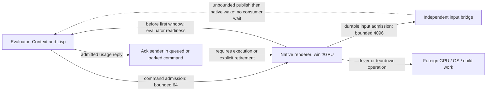

# Renderer/input backpressure: wait graph and progress contract

Status: revised after lead review #10889; implementation belongs to gapsurvey.
No implementation or test executed by this lane for this item yet.
Date: 2026-11-22.
Task: N-render-input-backpressure-cycle (lead mail #10804; peer #10807/#10813).
Source baseline: main `7081390b09baeb46530e5b674a366e7c309d1b5a`.
Prospective image-cache change: `2641d18d65847be732747992a7758f59030dc456`,
rebased in the 74c candidate as `06f2bef0be`; its code was also read at
`203ef106a9`. References below name their baseline explicitly.

## Revised finding and scope

The steady-state GUI input-capacity subgraph has no demonstrated cycle:
its independent input bridge forwards the bounded native input stream into
an unbounded evaluator stream. Lisp withholding input consumption does not
itself prevent that bridge from draining. The bridge audit below still holds.

The first revision incorrectly extended that result to synchronous query
liveness. Lead review found a real acknowledgement-lifetime defect in 2641:
an admitted PublishImageCacheUsage command can retain its acknowledgement
sender in Crossbeam's bounded buffer after the native receiver exits. The
evaluator retains command-sender clones while waiting on that acknowledgement,
so buffered payload destruction never occurs and the wait need not terminate.
A WindowClose in the unrelated core input queue does not interrupt this wait.

Startup deferral adds a different dependency: the renderer parks ordinary
commands before initial-window readiness and while GPU startup is pending.
A synchronous query that precedes evaluator-owned initial readiness can form
a true startup wait cycle. This requires the actual early-init reproduction;
the source path is identified below, not claimed observed yet.

Active renderer work can also stall independently of input consumption:
surface acquisition, GPU recovery, child reaping and GPU-resource retirement
run on or are joined from the native owner. Disconnect cleanup alone does
not provide a liveness policy for a live renderer blocked in those operations.

Gapsurvey owns the fix-forward product implementation and the first red row
for 2641, while this lane supplies the reviewed invariant and progress-test
design. Neither the disproven steady-state input cycle nor the unrelated
74c rich-buffer shaping regression is the explanation for this exit hang.

## Owners, wait graph and retained obligations



The dashed bridge arrow is not a wait-for edge. The readiness edge is
startup-only. The foreign-work edge does not imply an evaluator-owned lock,
but can prevent every command behind it from executing. Ack ownership is a
durable obligation, not a guarantee that the native receiver still exists.

### Buffered acknowledgement at exit

The lifetime trace at 2641 is:

1. `synchronize_cache_usage` creates a fresh std sync_channel(1), moves its
   only SyncSender into PublishImageCacheUsage, successfully admits that
   command, then calls `wait.recv()` (`image_catalog.rs:396-406` at 203ef).
2. Native exit drops the last command Receiver before executing that command.
   Crossbeam 0.5.15 `channel.rs:1150-1156` calls array disconnect; `array.rs:480-486`
   marks/wakes channel operations but does not destroy buffered payloads.
3. `counter.rs:67-73,122-128` deallocates the channel only after both endpoint
   families retire. Payload destructors run in `array.rs:522-555`, not on the
   first endpoint family's retirement.
4. The blocked evaluator and its display host/catalog retain Sender clones
   (`main.rs:4681,4702,4727`). The queued acknowledgement sender remains alive.
   Its std receiver cannot observe the unrelated Crossbeam disconnect.
5. Native WindowClose (`bootstrap.rs:616`) may be queued through the real
   bridge, but the evaluator cannot consume it while inside `wait.recv()`.

A source claim that failed command admission covers native exit is therefore
insufficient: admission can succeed before receiver retirement. Dropping an
ack-bearing value only when the command allocation is finally freed repeats
the lifetime bug. The exit protocol must settle admitted obligations even
while all evaluator Sender clones remain alive.

### Startup and recovery ownership matrix

| Phase | Queue ownership / wait | Required resolution |
|---|---|---|
| Before initial native-window readiness | PreparingCommands parks all nonShutdown commands (`startup.rs:124-138`); `:285-325` waits for evaluator-owned InitialWindowReply readiness. | Cache query/clear service must not depend on readiness that its blocked caller has not published. An empty-cache answer needs an authoritative pre-GPU accounting state and ordered invalidation, not a guessed timeout value. |
| Native primary pending, GPU attempt in progress | `lifecycle.rs:312-336` drains raw commands into `startup_commands` and returns when GPU is absent **and primary lifecycle is inactive**. | Startup must either service GPU-independent cache/control obligations in order or give them a terminal outcome that the caller can resolve correctly. A usage query must not silently wait forever for GPU creation. |
| Native/GPU ready | Parked commands precede raw channel commands (`command_processing.rs:9-38`); usage publication precedes `ack.try_send` (`asset_commands.rs:217-223`). | Preserve the clear/flush-to-publish prefix and success publication ordering. |
| Startup failure, native exit, is_shutting_down early exit | `lifecycle.rs:291-308`; StartingApp replaces phases with Stopped (`startup.rs:294,308,317,337,374,388`); RenderApp Drop calls handle_exiting (`app_handler.rs:124-128`). | Seal admission and resolve queued, parked and racing admitted obligations independently of later buffer destruction. |
| handle_exiting | Clears `startup_commands` (`lifecycle.rs:1152`) but not raw `cmd_rx`, before later teardown waits. | Clearing only parked commands misses raw-buffer replies. Draining raw commands once also misses publication racing after the drain unless admission is sealed or cancellation is independently observable. |
| Device-loss recovery | `bootstrap.rs:321-410` drops the old renderer and publishes usage, then synchronously rebuilds GPU state. | A reset is a new renderer generation, distinct from final exit; no old success may certify newer ownership. Outstanding queries need explicit completion/cancellation semantics throughout recovery. |

The startup dependency is reachable at the host interface: the image-cache
size builtin uses the host catalog directly without a realized-frame filter
(`neovm-display/.../image/mod.rs:1434-1443`), and clear-image-cache t requires
an installed display host (`:1380-1391,1412-1419`). That host exists before
GUI recursive_edit/early-init (`main.rs:4670-4718`). Initial readiness is
published only by finish_gui_frame_creation (`main.rs:1935-2020`, triggered
from `:2419-2432`) through `startup_frame.rs:58-79`. Thus an early-init
clear/size is a concrete reproduction candidate; it is not an observed red.

### Communication inventory

Locations are at 7081390b09 unless explicitly marked2641/203ef.

| Owner / operation | Source | Wait, saturation and terminal behavior |
|---|---|---|
| Evaluator ordinary command publication | `main.rs:1824-1834`; `thread_comm/command_projection.rs:24-26,43-45` | Command capacity 64 (`thread_comm.rs:830-831`). Full admission waits for native drain; receiver disconnect wakes admission with error. Successful admission is not proof of future execution. |
| Clipboard/video replies | `main.rs:1840-1847,3146-3179` | Fresh one-reply capacity 1,5s reply deadlines; the preceding blocking command admission has no corresponding deadline. Queued/deferred replies share the executor-lifetime problem even where their caller has a timeout. |
| Existing-main ordered cache waits | `image_catalog.rs:400-465` | Separate 100ms admission/ack limits can return a stale total. Reinstating stale-on-timeout behavior is not a freshness fix. |
|2641 ordered image invalidation and usage | `image_catalog.rs:396-446,519-561,880-893` at 203ef | Blocking flush/clear/usage admission followed by unbounded std ack receive. Exact buffered-ack exit hang above. |
| Durable native input | `thread_comm.rs:1284-1359` | Input capacity 4096 (`:830,1069`); send waits for the independent bridge. A stalled callback/command-generated send prevents native command pumping. |
| Lossy state input | `thread_comm.rs:1196-1206,1322-1342` | Pointer movement/WebView load progress use try_send and may be dropped under pressure; keys/buttons/close/presentation obligations retain durable ownership. |
| Native command pump | `app_handler.rs:70-78`; `lifecycle.rs:364`; `command_processing.rs:9-38` | try_recv itself does not block. Progress depends on returning from prior native callbacks, handlers, startup gates and recovery work. |
| Command-generated input | `surface_resize.rs:137-147`; `window_commands.rs:312`; `ui_commands.rs:107-127` | Resize/completion, retirement and popup results use the same durable input send; a second artificial drainer must not bypass this in tests. |
| Usage completion | `asset_commands.rs:217-223` | Shared usage publication precedes ack.try_send. If the handler is never invoked, capacity 1 does not release the caller. |
| Other asset/startup reply producers | `asset_commands.rs:322,345`; `gpu_startup.rs:32-41`; `startup.rs:61-85`; `thread_handle.rs:20,53-59` | One response fits its fresh capacity 1 channel. Each admitted obligation still needs an owner-lifetime terminal path; response-channel capacity is not a liveness proof. |
| Frame mailbox | `frame_mailbox.rs:51-84,102-142` | Per-frame coalescing with short mutex, try_send availability hint. Normal GUI ingest try_recv does not wait; no mutex spans a channel wait. |
| Image deferred submit worker | `image_catalog.rs:1094-1157` | Ordinary loads use try_send then an unbounded worker queue. Worker admission may block independently; ordered 2641 clears/usage do not use this path. Retained worker Sender clones reinforce why producer drop is not a cancellation authority. |
| Image redisplay notification | `image_catalog.rs:119-124` | Direct unbounded HostInputPublisher, without native 4096 capacity or evaluator-consumption wait. |
| GUI bridge receive/publication | `main.rs:4719,4731-4808`; `input_bridge/publication.rs:149-193`; `host_input.rs:277-310,388-393,410-434` | Independent select loop receives native input before conversion, unbounded core enqueue, then native wake. No core consumption dependency. |
| Bridge reverse font policy update | `main.rs:4736-4753` | try_send/latest pending snapshot/10ms retry; bridge continues draining input while command 64 is full. |
| Final native WindowClose | `bootstrap.rs:566,616` | Raw cloned input send can wait for bridge capacity after the loop; it cannot cancel a separate synchronous usage recv or substitute for executor-lifetime notification. |
| Evaluator normal shutdown | `main.rs:4879-4882` | try_send(Shutdown) ignores Full. A separate durability issue; do not use this lossy notification as the only terminal reply authority. |

### Renderer-independent waits and device loss

| Operation | Source / observed source bound | Liveness consequence |
|---|---|---|
| Surface acquisition | `render_pass/surface.rs:89` calls get_current_texture without an application deadline. | A native presentation/driver stall can delay every command behind it; no evaluator-side input drain can release that foreign operation. |
| Debug surface readback | `surface_readback.rs:133-141`: GPU poll up to 2s, then recv_timeout up to 2s. | These are sequential bounds, not a 2s bound on the complete request. Mark diagnostics separate from ordinary rendering, but include them in the query's liveness story when enabled. |
| Initial GPU attempt | Worker-backed completion and native try_recv (`gpu_startup.rs:203-245`). | Native can remain responsive, but deferred reply work still needs service/cancellation before readiness. |
| Device-loss reinitialization | `bootstrap.rs:21-61,321-410`: pollster::block_on adapter enumeration/device request at40/50 on native owner. | Unlike initial startup, recovery may block native command service independently of evaluator state. A caller deadline cannot rely on that blocked loop to emit its cancellation. |
| Recovery returns failure | `bootstrap.rs:379-387` relatches device loss, then the active-primary path can reach `lifecycle.rs:364` in the same pass. `media.rs:121-127` publishes default usage when renderer=None. | GPU absence alone does not imply startup deferral: its gate also requires an inactive primary. Distinguish returning failure from still being blocked in driver code. Actual owner publication of empty renderer usage is evidence; guessed 0 on timeout is not. |
| Terminal destruction | `terminal/view.rs:173-203`: kill owned child, child.wait, reader join inside command execution. | Native progress may wait for OS child/reader teardown independently of evaluator queues. |
| Renderer/GPU resource destruction | `lifecycle.rs:1184`; `submission_retirement.rs:75-91`: retirement worker GPU Wait timeoutNone, Drop joins worker. | Publish terminal query cancellation **before** entering these teardown waits. Late cancellation after destructor completion does not solve the exit hang. |

This note does not claim these foreign operations are all unbounded on every
backend. It identifies where the application supplies no completion bound,
where an explicit finite bound exists, and where independent cancellation is
needed. A successful steady-state progress row cannot prove those exit and
startup paths safe.

## Bridge publication audit

The module interface is `InputPublisher::publish_display/publish_core`.
Production and the progress test should cross that seam, retaining conversion,
frame routing, early quit, publication order and native notification together.

1. `input_bridge.rs:277-315,405-490` converts typed Rust data, including tracked
   receipts and presentation-qualified pointer input. It does not call Context,
   Lisp, an interner, or a GC safepoint. Internal presentation events stay in
   the same ordered stream as user actions.
2. `record_primary_window_resize` (`main.rs:1760-1785`) and primary-frame route
   resolution (`publication.rs:55-70`) take short copy/update mutexes. Audited
   evaluator writes (`main.rs:1954-1958,2057-2061,2252-2257`) release these
   guards before native command publication. No opposing lock/wait was found.
3. Early default C-g (`publication.rs:178-182`) calls `QuitRequest::request`
   (`crates/neovm-value/src/quit.rs:138-143`): atomic flag swap plus attention
   accounting, not evaluator acknowledgement or managed allocation.
4. `PublicationSession::enqueue/finish` (`host_input.rs:277-310`) borrows the
   connection, enqueues to the unbounded channel, and finishes its prefix
   notification (`:231-240`). Per-event publication neither clones/drops the
   session owner nor calls session nudge/disconnect.
5. `WaitNotifier::notify` (`crates/neovm-eval/src/emacs_core/runtime/eval/data/process_state.rs:1635-1641`)
   stores an atomic pending flag then calls `polling::Poller::notify`. The
   locked polling3.11.0 implementation coalesces via CAS (`src/lib.rs:799-812`),
   outside the wait mutex (`:751`); Linux normally writes an eventfd created
   NONBLOCK (`src/epoll.rs:444,488-498`). No evaluator reply is needed. Do not
   infer universal platform wait-freedom from this Linux source reading.
6. Host-session nudge is install-time (`host_input.rs:355-367`) or final-owner
   disconnect (`:185-205`), not normal per-input publication. Its control
   metadata lock is released before native notification (`host_effect/wake.rs:577-623`).
   The native control writer is nonblocking and treats WouldBlock as already
   pending (`wake.rs:1019-1024,1043-1066`).
7. Debug/error logging may incur external I/O latency. No inspected logger
   guard spans an evaluator renderer-request wait. Arbitrary custom logging
   subscribers or external stdout stalls are not claimed safe by this audit.

## GNU source contract and its limits

Read-only reference: GNU 31.1 at
`a360712c9d272d950d8d8255ef74570f7e90b7d9`.

- `src/keyboard.h:380-383` gives a4096-slot keyboard ring.
- `src/keyboard.c:3756-3774` defines ordinary FIFO insertion and held-quit
  handling; `:3787-3835` processes parsed C-g before ordinary capacity admission.
- `:3845-3863` explicitly discards an event that would consume the final ring
  slot, otherwise stores it and holds keyboard reading above half capacity.
  `:4045-4051` resumes below one quarter. TTY reading checks hold/free space
  before admission (`:8170-8184`). GNU therefore does **not** provide an
  unconditional promise that every posted hardware event survives overflow.
- `src/xterm.c:25662-25671,25747-25759` drains X/GTK events without a blocking
  publication to a separate evaluator channel. GNU's input hold and read loop
  differ from Neo's independent bridge; equality of physical queue occupancy
  is not an observable compatibility requirement.
- `src/image.c:2351-2365,2405-2419,2436-2471` frees matching frame/animation
  caches on the calling thread, under input blocking during mutation.
  `:12878-12901` reads those local caches synchronously. There is no renderer
  command/reply edge. A quiescent completed clear followed by the size query
  must not return the pre-clear ownership snapshot.

No GNU runtime or proposed progress row has been executed for this item yet:
observed liveness/accounting evidence is **UNATTESTED**. The canonical oracle
must pass `scripts/ci/check-gnu-oracle.sh` before the paired GUI row. Paste its
profile/features, the fixture form, and both actual outputs in the final receipt.

## Invariants required of the fix and its first consumer

Gapsurvey's2641 fix-forward is the first consumer of this contract.

1. Native input admission must not depend on evaluator consumption that can
   itself wait on rendering. Keep the independent bridge and its nonblocking
   font-policy reverse publication; do not manufacture a missing dependency.
2. **Every admitted ack-bearing command is answered or its acknowledgement
   ownership is retired on every native exit, startup-failure and terminal
   device-loss path.** This covers raw channel storage, both startup parking
   owners, in-flight commands and admission races. Retaining evaluator Sender
   clones may not retain a live obligation after its executor has retired.
3. Terminal state must seal admission or make independent cancellation
   observable to all admitted waiters, atomically with retirement. A single
   drain followed by receiver drop has a publication race. A cancellation
   guard inside the retained command payload has the original lifetime bug.
4. Publish terminal cancellation before potentially blocking GPU/clipboard/
   child teardown. It cannot depend on the evaluator consuming WindowClose,
   the event loop completing a blocked driver call, or the last Sender drop.
5. Completion and cancellation are distinct. Usage success certifies the
   clear/flush-to-publish command prefix and a Release publication before ack.
   Cancellation alone does not certify successful post-clear accounting.
   A response from an old renderer/reset generation cannot prove newer state.
6. **Renderer-independent waits need an explicit caller liveness policy.**
   Admission and acknowledgement are separate waits. A live renderer stuck
   in surface acquire/recovery must not strand the evaluator indefinitely.
   This requires either independent cancellation/health observation, service
   that does not depend on the stalled work, or an authoritative logical
   accounting state that can answer without it. The chosen policy belongs
   in the product fix; successful exit draining alone does not establish it.
7. A timeout must never blindly return the old pre-clear total or fabricate 0.
   Known post-clear 0 requires authoritative ordered invalidation/cache
   retirement (or an epoch-qualified logical snapshot), not elapsed time.
   Partial invalidation and intervening loads require their own byte/epoch
   accounting; do not generalize whole-cache clearing to those cases.
8. Before any native/GPU cache exists, a cache query must not wait for that
   cache to be created by evaluator readiness. Service GPU-independent cache
   operations or use a typed pre-GPU ownership state. Preserve order with
   parked loads/clears; do not let an old deferred load resurrect an invalidated
   cache after a query certified the clear. Exact early-init behavior needs
   the paired oracle form below, not a fabricated GLFW/GPU analogy.
9. Accepted non-lossy input retains FIFO and receipt ownership across all
   producers. No unrelated control queue reorder, committed-prefix replay,
   durable-input drop, or stale-size fallback is a valid way to get green.

The current cached_size_bytes()->i64 interface has no cancellation error arm.
The implementation must explicitly state how its terminal/starting/recovering
states produce an answer or unwind the waiting operation. Merely waking an
Err path and reading the old atomic avoids one hang but does not prove the
post-clear 0 contract. The design does not silently bless that exceptional
policy as GNU parity.

## Revised rows and detector contract

No row below has been executed by this lane. Gapsurvey owns the first exit
red and fix implementation; coordinate rather than duplicate those changes.

### Row1: genuine single-native-owner progress, plus detector control

- Use normal 4096/64 transport capacities and the genuine independent bridge
  into installed HostInputPublisher. The evaluator owns Context and does not
  consume core input while waiting on ordered clear/usage work.
- **One production renderer thread owns both native input publication and
  command handling.** Prefer an owned GUI process using the actual RenderApp
  event loop, or a reviewed test seam exercising its production dispatch and
  handlers on that same thread. Do not put input publication in one helper
  and command draining/acknowledgement in another: that can manufacture
  progress while the production native owner would be blocked.
- Flood at least 4097 admitted durable sequenced events while the evaluator's
  ordered operations are outstanding. Use a finite injector independent of
  completion; preserve posted-versus-admitted counts. Assert completion,
  ordered post-clear accounting and admitted FIFO/no-loss/no-dup after reads
  resume. Include full command admission and a pending font update if the
  production seam supports them without a second copied select-loop model.
- Do not use make_test_app() unchanged for this row: that helper drops its
  `_emacs` counterpart on return (`render_thread_test.rs:19-32`), disconnecting
  the channels being tested. Construct RenderApp while retaining the actual
  evaluator endpoints (the existing `:729-750` pattern), and create/drop the
  non-Send native app on its sole owner thread.
- A separate detector owns only the deadline and process/thread cleanup; it
  may not consume input, drain commands, send usage acks, release a resource
  needed by the evaluator, or otherwise make the product progress before
  recording its result. Recovery releases after a recorded timeout are cleanup,
  never product completion.
- **Negative detector check:** an intentionally blocking sink on the production
  dispatch seam must be reported as timeout/missing progress within the bound.
  The detector must reap/terminate only its owned fixture process afterward.
  A detector that says pass because another drainer answered is invalid.
- Run any deliberately nonreturning scenario in an owned child so timeout
  cleanup cannot hang a scoped-thread join. A test rescue occurs only after
  recording timeout, and cannot be mistaken for product completion.

### Row2: admitted buffered ack survives receiver exit (expected red on2641)

Admit PublishImageCacheUsage into the real bounded command channel, prove
successful admission, retain evaluator command-Sender clones, and retire the
native executor without executing that queued command. The evaluator must
finish or observe an explicit terminal outcome before a generous deadline.
**Keep those Sender clones alive until after the completion assertion.**
Dropping them as a rescue before asserting would destroy the retained ack and
hide the defect. If the2641 baseline fails, preserve that timeout receipt,
then clean up the owned child independently. The green side must also retain
the clones and preserve the quiescent clear/size0 result on the live path.
For a narrowly scoped channel-lifetime control, the waiter may drop its own
command Sender immediately after admission while the controller retains the
proving clone; after recording timeout, dropping that final retained clone
allows the queued ack to destruct before joining the waiter. If the real
catalog waiter necessarily retains its own Sender, isolate it in an owned
child instead of leaking a hung thread or making the cleanup rescue pass.

### Row3: startup parking, pre-readiness and failure

Cover both PreparingCommands before initial-window readiness and RenderApp's
GPU-pending startup_commands. Query/clear before readiness must not wait for
its own evaluator's later readiness publication. Include worker failure,
missing surface permission/cancellation and shutdown with replies in each
parking owner. Verify that admitted replies terminate on failure and that
successful startup preserves command-prefix semantics. The actual early-init
form is a candidate until run on both binaries:

```elisp
(list window-system
      (progn (clear-image-cache t) (image-cache-size)))
```

Run in a private early-init fixture with an attested GNU 31.1 oracle; record
before/after receipts and a separate first-frame/init-complete receipt. Use
private `--init-directory DIR --no-site-file`, not -Q/-q: those suppress the
very init-file arm under test. GNU `startup.el:1055,1533-1541,1591-1604` loads
early-init before window-system initialization and first graphical frame.
A batch -Q control may establish `(list (clear-image-cache t)
(image-cache-size))` separately, but is not GUI startup evidence. Record
GNU's actual initial-terminal/frame behavior and error data as well as result.
Do not assume the initial terminal already has a GUI/GPU cache. A no-argument
size before any clear is a separate control, since no invalidation may mean
no native usage request is pending.

### Row4: retirement races and device recovery

Race successful admission against terminal transition; include dequeue into
each startup owner, completion versus cancellation, redundant terminal calls,
and a receiver clone retained by setup. Require every admitted obligation to
settle exactly once while caller Sender clones remain alive. A normal device
reset is not final exit: distinguish old/new cache generations and preserve
valid successful completion if it already published before cancellation.

Exercise a native recovery operation that remains blocked and one that
returns failure. The latter may legitimately service a no-renderer usage
request; the former requires the independent caller liveness policy. Exercise
terminal cancellation before the existing injected submission-retirement
waiter is released, proving teardown completion is not needed to wake callers.

### Row5: paired accounting/progress evidence

Private X11, pinned attested GNU versus Neo. An owned finite native input burst
runs during ordinary image work; require completion and a subsequent marker
without equal iteration-rate or exact hardware-overflow admission assertions.
Separately, in a quiescent single-frame/animation-free state, compare
`(progn (clear-image-cache t) (image-cache-size))`, actual value/type/error.
The live post-clear result must remain 0 as required by the existing attested
image-cache contract. A cancelled native actor is a different path and must
not be presented as that successful oracle comparison.

## Alternatives and design horizon

Existing seam: ThreadComms/RenderComms plus the independent InputPublisher.
The input-capacity interface remains justified by its independent bridge.
The command/reply interface needs an explicit executor-lifetime and startup
contract: one module should own accepted reply obligations, cancellation and
published accounting facts. This keeps knowledge local instead of having each
caller rediscover Crossbeam buffer lifetimes or add an arbitrary timeout.

If a future real dependency requires native callbacks to return while the
bridge is stalled, an ordered non-lossy overflow owner could remove renderer
capacity waits. That design must include every producer (raw input clones,
AppKit quit, final exit), FIFO across overflow and ordinary sends, retry wake
and teardown ownership, plus the bounded-memory/lossless/nonblocking tradeoff.
The downstream evaluator queue is already unbounded; an additional overflow
queue does not create an end-to-end memory bound. A separate unbounded GUI
transport could be simpler, but would still require preserving the existing
lossy-state pressure policy and intentional TTY backpressure. Neither input
transport change fixes the confirmed retained-ack defect:
that defect concerns executor/reply lifetime, startup gating and independent
renderer stalls, even when the input bridge is making progress.

Primary sources opened for internal design:

- [Crossbeam 0.5.15 Sender](https://docs.rs/crossbeam-channel/0.5.15/crossbeam_channel/struct.Sender.html):
  bounded send waits for capacity; try_send returns ownership on failure.
- [Crossbeam bounded storage](https://raw.githubusercontent.com/crossbeam-rs/crossbeam/crossbeam-channel-0.5.15/crossbeam-channel/src/flavors/array.rs)
  and [endpoint counters](https://raw.githubusercontent.com/crossbeam-rs/crossbeam/crossbeam-channel-0.5.15/crossbeam-channel/src/counter.rs):
  disconnect marks/wakes; buffered payload destruction depends on both endpoint
  families retiring. The exact locked local files were opened in this audit.
- [Polling 3.11 Poller](https://docs.rs/polling/3.11.0/polling/struct.Poller.html#method.notify):
  notification wakes a current or future wait, rather than asking the consumer
  to synchronously handle a callback. The locked local implementation was
  also inspected as described above.
- [Winit ApplicationHandler](https://rust-windowing.github.io/winit/winit/application/trait.ApplicationHandler.html):
  native handlers and the command-drain pass share one loop; its channel
  example deliberately avoids blocking receives in the callback.

These sources inform internal queue design. GNU's pinned source and attested
observations remain the observable-behavior authority.

## Distinct follow-ups, not diagnosed as this cycle

The final raw input send at `bootstrap.rs:616` can delay teardown if its bridge
is gone but the receiver is still retained. Normal evaluator shutdown also
ignores a full command queue at `main.rs:4879-4882`; the post-GPU bootstrap drops
its evaluator-lifetime observer (`render_thread/startup.rs:390-392`). A
saturated-queue shutdown may therefore need its own durable termination
contract and red row. Do not silently fold that into an unproved image-cache
cycle or claim that correcting it alone resolves the retained-ack exit defect.
The raw exit notification must not be the sole cancellation authority for
admitted command replies.
